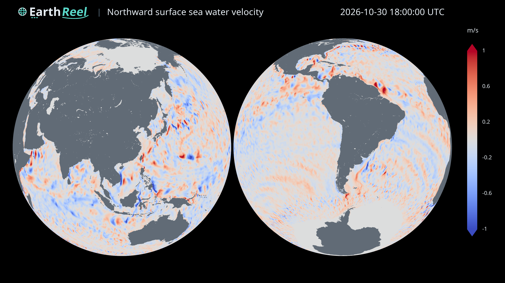

<picture>
  <source media="(prefers-color-scheme: dark)" srcset="src/earthreel/assets/earthreel-logo-dark.svg">
  
</picture>

**English** | [简体中文](README.zh-CN.md)

Turn atmospheric, oceanic, and other Earth science data into 3D globe imagery with scientific annotations.

EarthReel is in early development. It currently supports PNG snapshots and rotating-globe MP4 videos at a fixed data time for temperature and velocity component fields on global regular latitude–longitude grids. GRIB1/GRIB2 temperature and velocity component data can be read with the optional `grib` dependency ([IFS example, in Chinese](examples/README.md#ifs-grib-气温示例)). ERA5 2 m temperature data is included in the repository so you can reproduce the demo without additional downloads.

## IFS 4K Showcase

All three images below were generated with EarthReel using ECMWF IFS **0.1° global grids, with a 0-hour forecast initialized at 2026-10-30 18:00 UTC**, at **3840 × 2160** resolution. The dual-globe layout shows two opposite views of the same time. Click an image to view it at full resolution.

### 2 m Temperature · t2m

Global near-surface air temperature in °C. The color scale spans −60 to 40°C, with 0°C separating cool and warm colors.

[](docs/images/ifs-4k/ifs_t2m_0h_4k.png)

### Eastward Surface Ocean Current · sve

Red indicates eastward flow and blue indicates westward flow; color intensity represents the component magnitude. Gray indicates missing data.

[](docs/images/ifs-4k/ifs_sve_0h_4k.png)

### Northward Surface Ocean Current · svn

Red indicates northward flow and blue indicates southward flow. Both current components share a −1 to 1 m/s color scale centered on zero for easy comparison. They represent individual directional components, not the combined current speed. Values outside the color range use the endpoint colors; the underlying values remain unchanged.

[](docs/images/ifs-4k/ifs_svn_0h_4k.png)

Data source: [ECMWF IFS Open Data](https://www.ecmwf.int/en/forecasts/datasets/open-data), licensed under CC BY 4.0.
Based on data and products of ECMWF. EarthReel performs unit conversion (temperature K → °C), spherical mapping, and color mapping.
The three 4K showcase images are included in the repository. Local source data and other rendering outputs are ignored by default.

## Current Features

| Feature | Current support |
| --- | --- |
| Data formats | NetCDF (netCDF4 engine), uncompressed GRIB1/GRIB2 (optional `grib` dependency) |
| Grids | Global regular latitude–longitude grids with 1D latitude and longitude; input resolution is preserved without downsampling |
| Variables and units | Temperature in K / °C (displayed in °C), velocity components in m/s (units preserved) |
| Time selection | One time step from a single file; supports 1D time coordinates and scalar time for single-time GRIB data |
| Globe display | Single globe or two opposite views orbiting in sync; connected longitude seam and closed polar regions |
| Color mapping | Configurable colormaps and ranges; linear or two-slope normalization with a specified center; out-of-range values only clip colors |
| Grid display | Per-cell coloring by default, with optional continuous interpolation; missing values are preserved and shown in gray |
| Annotations | EarthReel logo, variable title, UTC time, shared colorbar, and units |
| Output | PNG snapshots and H.264 MP4; configurable defaults of 2560 × 1440, 60 fps, and 20 seconds |
| Reproducibility | A JSON sidecar for each output records configuration, data SHA-256, time, units, processing notes, and software versions |
| Interface | YAML scene configuration and `snapshot` / `render` commands, with CLI overrides for common output settings |

Videos currently use a fixed data time while only the camera rotates. Regional grids, native ICON triangular grids, 2D curvilinear coordinates, multi-level selection, time evolution, streamlines/particles, interactive previews, online downloads, and dedicated Zarr/HDF5/CSV inputs are not yet implemented.
Compressed GRIB files must be decompressed first. The presence of other variables in a file does not imply support for their units or visualization methods.

## Verified Examples

| Scene | Variable | Input grid | Color range | Configuration |
| --- | --- | --- | --- | --- |
| ERA5 2 m temperature | `t2m` | 0.25°, 721 × 1440 | −60 to 40°C, centered at 0°C | [era5_t2m.yml](examples/era5_t2m.yml) |
| ERA5 sea surface temperature | `sst` | 0.25°, 721 × 1440 | −2 to 32°C, linear | [era5_sst.yml](examples/era5_sst.yml) |
| IFS 2 m temperature | `t2m` | 0.1°, 1801 × 3600 | −60 to 40°C, centered at 0°C | [ifs_t2m.yml](examples/ifs_t2m.yml) |
| IFS eastward surface ocean current | `sve` | 0.1°, 1801 × 3600 | −1 to 1 m/s, centered at 0 | [ifs_sve.yml](examples/ifs_sve.yml) |
| IFS northward surface ocean current | `svn` | 0.1°, 1801 × 3600 | −1 to 1 m/s, centered at 0 | [ifs_svn.yml](examples/ifs_svn.yml) |

The ERA5 t2m sample is tracked in the repository. SST and IFS configurations require locally downloaded data.
See the [example guide (in Chinese)](examples/README.md) for detailed commands and display semantics.

## Development Environment

Python 3.11 or later is supported. Python 3.13 is recommended for development and rendering.

```bash
python3.13 -m venv .venv
source .venv/bin/activate
python -m pip install -e '.[dev]'
earthreel --help
earthreel --version
```

You can also run `python -m earthreel --version`.

With uv, you can use `uv venv --python 3.13 .venv` and `uv pip install -e '.[dev]'`. MP4 encoding uses FFmpeg provided by imageio-ffmpeg, so a separate system FFmpeg installation is unnecessary. Rendering requires a working OpenGL environment; see the [example guide (in Chinese)](examples/README.md) for headless Linux setup.

## Generate the ERA5 Demo

From the repository root, with the virtual environment activated, run:

```bash
earthreel snapshot examples/era5_t2m.yml --output outputs/era5_t2m.png
earthreel render examples/era5_t2m.yml --output outputs/era5_t2m.mp4
# Single-globe layout
earthreel render examples/era5_t2m.yml --layout single --output outputs/era5_t2m_single.mp4
# Dual-globe layout (default)
earthreel render examples/era5_t2m.yml --layout dual --output outputs/era5_t2m_dual.mp4
```

By default, the demo uses temperature at 2000-01-01 00:00 UTC and produces a 2560 × 1440 (1440p) snapshot and a 20-second orbit video at 60 fps. Frames are encoded directly with H.264 CRF 22 / slow using inter-frame prediction; adjust these settings with `--crf` and `--preset`. Use `--time-index 1` or `--time-index 2` to select 01:00 or 02:00 UTC; the data time stays fixed throughout the video. For a quick preview, use `--width 640 --height 360 --fps 6 --duration 2`. Existing outputs require `--overwrite`.

Choose a single- or dual-globe layout with `display.layout: single` / `dual` or the CLI option `--layout`; the CLI takes precedence. The default dual-globe layout shares data, time, and a colorbar. Its initial view centers are 110°E / 30°N and 70°W / 30°S, with exactly opposite viewing directions orbiting in sync. The single-globe layout uses the first view and displays a larger globe. Both layouts use a transparent PNG derived from the same EarthReel vector wordmark as the logo in the upper-left corner of the video.

Each output includes a `.png.json` or `.mp4.json` run record containing the effective configuration, source data SHA-256, data time, software versions, and display processing notes. See the [example guide (in Chinese)](examples/README.md) for detailed configuration and limitations.

## Checks

```bash
ruff check .
pytest -m 'not render'
EARTHREEL_RENDER_TESTS=1 pytest -m render
```

CI checks installation, data, and configuration on Python 3.11 / 3.13. It also checks PNG output, short MP4 videos, and the real ERA5 example in a Linux software-rendering environment on Python 3.13.

## Technical Direction

EarthReel uses a Python stack: xarray for data preparation and PyVista/VTK for scene rendering, producing PNG and MP4 outputs. GeoVista may be introduced as needed to support complex grids.

Input grid resolution is currently preserved, with ERA5 0.25° and IFS 0.1° verified. Temperature is converted from K to °C, while velocity stays in m/s. Lighting is disabled for the scientific data layer, with a fixed color scale, variable long name, and time. Data sources and licensing are recorded in documentation, configurations, and run records. Time evolution, interactive previews, and complex grids are planned for later.

## Repository Structure

```text
src/earthreel/    Python package and CLI entry point
docs/            Architecture and development plans
examples/        ERA5 / IFS scene configurations and reproduction guides
demo_data/       ERA5 sample, locally downloaded data, and data licensing notes
data/            Local data (ignored by default)
outputs/         Rendered outputs (ignored by default)
```

See the [architecture guide (in Chinese)](docs/architecture.md) for module boundaries and future plans. The repository includes the ERA5 t2m sample and three IFS 4K showcase images. Other local data, credentials, and generated videos are excluded from version control by default.

## License

EarthReel code is licensed under the [Apache License 2.0](LICENSE). See [NOTICE](NOTICE) for copyright notices.

Third-party data, Earth textures, and sample assets are subject to their respective license terms; the project license does not replace them.

See the [asset guide (in Chinese)](src/earthreel/assets/README.md) for the sources and licenses of the bundled NASA Blue Marble land/ocean basemap and Noto Sans font. The font uses SIL OFL 1.1, which permits commercial use. All current on-screen text uses the same font file.
