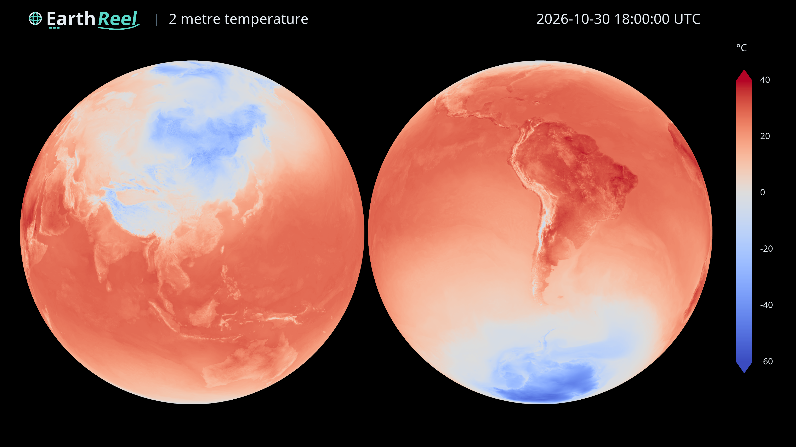
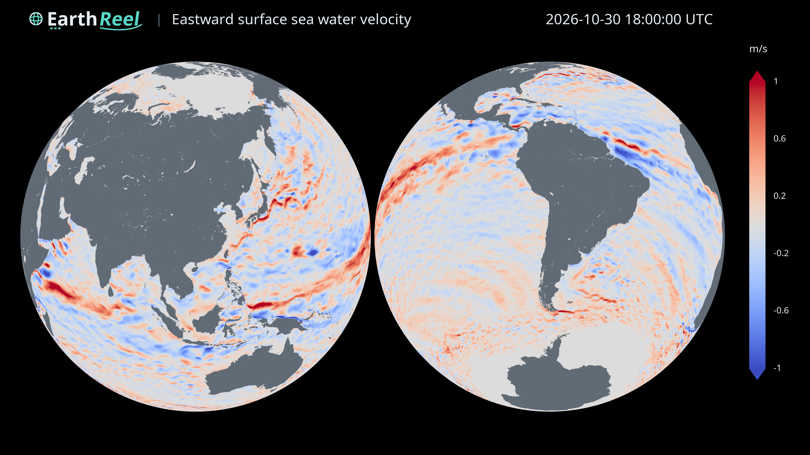

<picture>
  <source media="(prefers-color-scheme: dark)" srcset="src/earthreel/assets/earthreel-logo-dark.svg">
  
</picture>

将大气、海洋等地球科学数据制作成具有科学标注的三维地球影像。

项目处于早期开发阶段，已支持全球规则经纬网格温度和速度分量场的 PNG 静帧与固定时刻的旋转地球 MP4。支持通过可选 `grib` 依赖读取 GRIB1/GRIB2 温度和速度分量数据（[IFS 示例](examples/README.md#ifs-grib-气温示例)）。仓库内附带 ERA5 2 米气温数据，无需额外下载即可复现。

## IFS 4K 渲染展示

以下三张图均由 EarthReel 使用 ECMWF IFS 的 **0.1° 全球网格、2026-10-30 18:00 UTC 起报的 0h 数据**生成，
输出分辨率为 **3840 × 2160**。双球展示同一时刻的两个反向视角；点击图片可查看原图。

### 2 米气温 · t2m

展示全球近地面气温分布，单位为 °C。色标范围为 −60～40°C，以 0°C 为冷暖色分界。

[](docs/images/ifs-4k/ifs_t2m_0h_4k.png)

### 东西向表层海流 · sve

红色表示向东、蓝色表示向西，颜色深浅表示分量大小；灰色为缺测区域。

[](docs/images/ifs-4k/ifs_sve_0h_4k.png)

### 南北向表层海流 · svn

红色表示向北、蓝色表示向南。两个海流分量共用 −1～1 m/s 色标，以 0 为中心，便于对照；
它们分别表示方向分量，并非合成流速。超出色标范围的数值使用端点颜色，原始数值保持不变。

[](docs/images/ifs-4k/ifs_svn_0h_4k.png)

数据来源：[ECMWF IFS Open Data](https://www.ecmwf.int/en/forecasts/datasets/open-data)，采用 CC BY 4.0。
Based on data and products of ECMWF；由 EarthReel 进行单位转换（温度 K → °C）、球面映射和配色。
三张 4K 展示图随仓库提供，本地原始数据和其他渲染输出默认忽略。

## 当前功能

| 功能 | 当前支持 |
| --- | --- |
| 数据格式 | NetCDF（netCDF4 引擎）、未压缩 GRIB1/GRIB2（可选 `grib` 依赖） |
| 网格 | 全球规则经纬网格，一维纬度和经度；保留输入分辨率，不降采样 |
| 变量与单位 | 温度 K / °C（显示为 °C）、速度分量 m/s（保持原单位） |
| 时间选择 | 单文件内选择一个时次；支持一维时间及 GRIB 单时次的标量时间 |
| 球面显示 | 单球或两个反向视角同步环绕；经度接缝连接和极区闭合 |
| 配色 | 可选色表、手动范围、线性或指定中心的双色归一化；超范围仅截断颜色 |
| 格点显示 | 默认每格独立着色；可选连续插值；缺测保留并显示为灰色 |
| 画面标注 | EarthReel logo、变量标题、UTC 时间、共享色标与单位 |
| 输出 | PNG 静帧、H.264 MP4；默认 2560 × 1440、60 fps、20 秒，可配置 |
| 复现记录 | 每个输出附 JSON，记录配置、数据 SHA-256、时刻、单位、处理说明和软件版本 |
| 操作方式 | YAML 场景配置及 `snapshot` / `render` 命令，常用输出参数支持命令行覆盖 |

视频目前固定数据时刻，仅相机旋转。区域网格、ICON 原生三角网格、二维曲线坐标、多层选择、
时间演变、流线/粒子、交互预览、在线下载，以及 Zarr/HDF5/CSV 专用入口尚未实现。
压缩 GRIB 需先解压；文件包含其他变量不代表已支持其单位或绘制方式。

## 已验证的示例

| 场景 | 变量 | 输入网格 | 色标范围 | 配置 |
| --- | --- | --- | --- | --- |
| ERA5 2 米气温 | `t2m` | 0.25°，721 × 1440 | −60～40°C，中心 0°C | [era5_t2m.yml](examples/era5_t2m.yml) |
| ERA5 海表温度 | `sst` | 0.25°，721 × 1440 | −2～32°C，线性 | [era5_sst.yml](examples/era5_sst.yml) |
| IFS 2 米气温 | `t2m` | 0.1°，1801 × 3600 | −60～40°C，中心 0°C | [ifs_t2m.yml](examples/ifs_t2m.yml) |
| IFS 东西向表层海流 | `sve` | 0.1°，1801 × 3600 | −1～1 m/s，中心 0 | [ifs_sve.yml](examples/ifs_sve.yml) |
| IFS 南北向表层海流 | `svn` | 0.1°，1801 × 3600 | −1～1 m/s，中心 0 | [ifs_svn.yml](examples/ifs_svn.yml) |

ERA5 t2m 示例已随仓库跟踪；SST 和 IFS 配置依赖本地下载的数据。
详细命令及显示语义见 [示例说明](examples/README.md)。

## 开发环境

支持 Python 3.11 或更高版本，开发及渲染建议使用 Python 3.13。

```bash
python3.13 -m venv .venv
source .venv/bin/activate
python -m pip install -e '.[dev]'
earthreel --help
earthreel --version
```

也可以运行 `python -m earthreel --version`。

使用 uv 时也可运行 `uv venv --python 3.13 .venv` 和 `uv pip install -e '.[dev]'`。MP4 编码使用 imageio-ffmpeg 提供的 FFmpeg，无需单独安装系统 FFmpeg。渲染需要可用的 OpenGL 环境；Linux 无显示环境的安装方式见 [示例说明](examples/README.md)。

## 生成 ERA5 Demo

在仓库根目录、激活虚拟环境后运行：

```bash
earthreel snapshot examples/era5_t2m.yml --output outputs/era5_t2m.png
earthreel render examples/era5_t2m.yml --output outputs/era5_t2m.mp4
# 单地球布局
earthreel render examples/era5_t2m.yml --layout single --output outputs/era5_t2m_single.mp4
# 双地球布局（默认）
earthreel render examples/era5_t2m.yml --layout dual --output outputs/era5_t2m_dual.mp4
```

默认使用 2000-01-01 00:00 UTC 气温，输出 2560 × 1440（1440p）静帧和 20 秒、60 fps 的环绕视频。生成时直接以 H.264 CRF 22 / slow 编码压缩，使用帧间预测；可用 `--crf` 和 `--preset` 调整。使用 `--time-index 1` 或 `--time-index 2` 选择 01:00 或 02:00 UTC；全片数据时间固定。通过 `--width 640 --height 360 --fps 6 --duration 2` 可快速预览。输出已存在时需要 `--overwrite`。

通过 `display.layout: single` / `dual` 或命令行 `--layout` 选择单球或双球布局，命令行优先。默认双球共用数据、时间和色标，初始观察中心为 110°E / 30°N 和 70°W / 30°S，观看方向严格相反并同步环绕。单球使用第一个视角，放大显示地球。两种布局均使用同一个 EarthReel 矢量字标的透明 PNG 衍生图作为视频左上角 logo。

每个输出附带 `.png.json` 或 `.mp4.json` 运行记录，包含实际配置、源数据 SHA-256、数据时刻、软件版本及显示处理说明。详细配置和限制见 [示例说明](examples/README.md)。

## 检查

```bash
ruff check .
pytest -m 'not render'
EARTHREEL_RENDER_TESTS=1 pytest -m render
```

CI 在 Python 3.11 / 3.13 检查安装、数据和配置，并在 Python 3.13 的 Linux 软件渲染环境检查 PNG、短 MP4 和真实 ERA5 示例。

## 技术方向

采用 Python 技术栈：xarray 负责数据准备，PyVista/VTK 负责场景渲染，最终生成 PNG 和 MP4。复杂网格适配可在后续按需引入 GeoVista。

当前保留输入网格分辨率，已验证 ERA5 0.25° 和 IFS 0.1°；温度 K 转 °C、速度保留 m/s；科学数据层关闭光照，固定色标、变量长名称和时间。数据来源及授权保存在文档、配置和运行记录中。后续再加入时间演变、交互预览和复杂网格。

## 仓库结构

```text
src/earthreel/    Python 包及命令行入口
docs/            架构与开发规划
examples/        ERA5 / IFS 场景配置与复现说明
demo_data/       ERA5 示例、本地下载数据及数据许可说明
data/            本地数据（默认忽略）
outputs/         渲染产物（默认忽略）
```

模块边界与后续计划见 [架构说明](docs/architecture.md)。仓库包含 ERA5 t2m 示例与三张 IFS 4K 展示图；其他本地数据、凭据和生成的视频默认不纳入版本控制。

## 许可

EarthReel 代码采用 [Apache License 2.0](LICENSE)，版权声明见 [NOTICE](NOTICE)。

第三方数据、地球纹理及示例素材遵循各自的授权条款；本项目许可证不替代这些授权。

随包分发的 NASA Blue Marble 海陆底图及 Noto Sans 字体的来源和许可见 [素材说明](src/earthreel/assets/README.md)。字体采用 SIL OFL 1.1，允许商用；所有当前画面文字使用同一字体文件。
